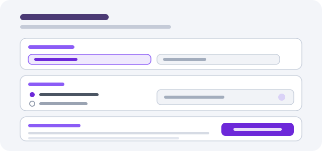

# dsh-session-title-tools

[](https://github.com/CrystalVibe28/dsh-session-title-tools/actions/workflows/ci.yml)

[DeepSeek Harness](https://github.com/deepseek-ai/deepseek-harness)（DSH）的**會話標題工具**：兩個代理工具加上一個設定頁面，讓模型讀取與重新命名目前會話的標題，並管理 DSH 原生的標題生成。

- `session_title_read`：讀取呼叫端會話目前的標題；尚未設定時回傳空字串。
- `session_title_set`：重新命名目前會話。工具描述直接帶有 DSH 原生標題規則（一行純文字、使用訊息語言、目前的詞數／CJK 字數目標），由呼叫工具的模型自行產生標題，**工具本身不呼叫模型**。新標題會被 **pin**：之後的訊息不會再觸發自動標題生成。
- **設定 → 外掛 → 會話標題** 管理 DSH 原生的標題生成：
  - **生成模式**：透過原生 plugin-manager remote 切換出廠的 `first-prompt` 提供者（base）與 `all-prompts` 提供者（實驗性 session-titles bundle）。頁面會回報切換的實際結果並讀回權威狀態，因此 DSH 的「外掛」頁面顯示相同內容；在 DSH 外掛頁手動切換會在啟動時被尊重，不會被再次覆寫。
  - **標題模型**：跟隨會話執行中的模型，或固定任意已安裝 adapter 提供的模型。設定會投影到實際執行中的原生提供者資料列，切換模式後也一樣。
  - **原生系統提示詞**：預覽 DSH 送出的提示詞，內容由原生 `targetWords`／`targetCjkCharacters` 目標推導。編輯目標會寫入提供者自己的設定；**還原原生預設值**會回到 `5` 詞／`10` 個 CJK 字元。



兩個工具只需要 `tools`、`sessions`、`sessionTitle`；管理功能在 `configEditor` 存在時才會啟用，原生提供者無法更新時會降級為 Host 記錄的錯誤。

## 相容性

套件宣告 `engines.dsh`（`>=0.2.2-rc.3 <0.3.0`），因為它會讀取執行中 DSH 的提供者資料列與設定編輯器。若 DSH 版本超出此範圍，DSH 會以相容性診斷略過這個 bundle；原生標題生成不受影響。

## 安裝

這是標準 DSH bundle（`package.json` 內含 `dsh.bundle.patch` 與 `dsh.client`），**直接從 GitHub 安裝即可，不需要 clone**：

1. 開啟 DSH 的 **外掛 → 安裝**，貼上倉庫網址：

   ```
   https://github.com/CrystalVibe28/dsh-session-title-tools
   ```

   等效於 `github:CrystalVibe28/dsh-session-title-tools`：pnpm 會抓 `main` 分支的 tarball，並在 `~/.dsh/profiles/<profile>/pnpm-lock.yaml` 鎖定當時的 commit。
2. 依 DSH 指示重新啟動 Host（Host 變更需要重啟；頁面變更需要重新整理瀏覽器）。

開發迭代時改用 `link:` 指向本機目錄，改完重新載入即生效：

```bash
plugin_manager install_bundle target=link:/absolute/path/to/dsh-session-title-tools
```

> 從 GitHub 安裝的是**某個 commit 的快照副本**（放在 `~/.dsh/profiles/<profile>/node_modules/@crystalvibe28/dsh-session-title-tools`），本機改了原始碼不會自動反映。介面會以 `already-installed` 拒絕重複安裝，因此更新方式是**先移除外掛、再貼網址重新安裝**（或直接對 profile 執行 `pnpm add github:CrystalVibe28/dsh-session-title-tools`，會重新解析 `main` 的最新 commit）。

### npm registry（選用）

發佈到 npm 後，也可以改用 registry 版本安裝。DSH 只以 npm registry 的 semver 清單判斷外掛是否有更新，因此只有 registry 安裝版本會在外掛頁的「版本」區塊顯示更新按鈕：

```
@crystalvibe28/dsh-session-title-tools
```

本倉庫目前**尚未發佈到 npm**；`Release` workflow 預設為 opt-in（見 [GitHub Actions](#github-actions)），未設定 `NPM_TOKEN` 與倉庫變數 `NPM_PUBLISH=true` 時不會發佈。

## 使用方式

安裝後在對話中直接要求模型使用工具即可，例如：

```text
請用 session_title_read 讀取目前的會話標題。
請用 session_title_set 把標題改成「修正 CI 快取」。
```

模型會依工具描述裡的 DSH 原生規則產生標題，再以 `title` 參數送出；空字串或只有空白會被拒絕。設定頁面則從 **設定 → 外掛 → 會話標題** 進入。

## 原生設定怎麼被套用

1. 設定頁只寫入這個外掛自己的 volatile 設定（`modelKind`、`provider`、`model`、`targetWords`、`targetCjkCharacters`）。
2. Host 半部訂閱 `loader/volatile-update`，把變更排進序列化佇列，再找出**實際執行中**的原生提供者資料列（`session-title-llm` 或 `optional-session-title-all-prompts`），以 `configEditor.edit` 投影模型與長度設定。
3. 啟動或 profile 重新組合後，只有在明確指定模型或非預設長度時才重新套用；**生成模式不會在啟動時被重新宣告**，所以在外掛頁手動切換的結果會保留。
4. 若投影失敗（沒有執行中的提供者資料列，或值被 home patch 釘住），錯誤會寫入 Host 記錄，頁面無法顯示。

## 移除

1. 從 **外掛** 頁面移除 bundle（或 `dsh plugin remove @crystalvibe28/dsh-session-title-tools`）。這會取消選取、卸載並移除 profile 相依性。
2. 刪除 profile 的 `cordis.patch.yml` 裡留下的項目：

   ```yaml
   - id: session-title-tools
     name: '@crystalvibe28/dsh-session-title-tools'
     config: {}
   ```

   profile patch 是使用者撰寫的內容，移除外掛不會動它，因此會留下孤兒項目，DSH 啟動時會警告 `patch: entry "session-title-tools" not found`。這只是警告，該項目會被略過。
3. 決定生成模式。實驗性 session-titles bundle 是獨立的出廠 bundle，移除外掛後若曾啟用仍會保持選取；要回到 DSH 的 first-prompt 預設，請在 **外掛** 頁面關閉它。
4. 檢查 profile patch 是否留有本外掛投影的原生提供者覆寫（`session-title-llm` 或 `optional-session-title-all-prompts` 上的 `targetWords`、`provider`、`model`）。移除外掛後它們仍會套用到原生提供者；要回到出廠預設請刪除這些項目。
5. 重新啟動 DSH。

移除外掛不會動到 DSH 的安裝目錄，已經 pin 的標題也會保持 pinned（它們是持久的 `session/title` 事件）。

## 開發與測試

```bash
node --test test/*.test.mjs
```

測試以最小的 Host context 模擬 `tools`、`sessions`、`sessionTitle` 與 `configEditor`，涵蓋工具註冊、長度變更後的描述更新、模型投影、資料列切換與 provider 選擇。

## 專案結構

```
lib/index.js          Host 半部：兩個工具與原生標題設定投影
client.js             Web 半部：設定頁面、字串與模型清單
cordis.patch.yml      插入 session-title-tools 資料列
locale/*.json         外掛顯示名稱（en／zh／zh-TW）
docs/DETAIL.md        外掛詳細說明
docs/preview.svg      設定頁預覽圖
icon.svg              外掛圖示
test/*.test.mjs       Host 半部測試
.github/workflows/    CI 與 opt-in npm 發佈
```

## GitHub Actions

- **`.github/workflows/ci.yml`**（push／PR／可手動觸發）：以 Node.js 24 檢查 `lib/index.js` 與 `client.js` 語法、執行 `node --test`，並用 `npm pack --dry-run` 確認實際會發佈的檔案集合。
- **`.github/workflows/release.yml`**（push 到 `main`、可手動觸發）：讀取 `package.json` 版號，若 npm registry 還沒有這個版本就 `npm publish --access public`。**預設不會發佈**：必須同時符合以下兩個條件才會啟用，否則只留一則 notice 並略過，不會讓 CI 失敗：
  - 倉庫變數 `NPM_PUBLISH=true`（Settings → Secrets and variables → Actions → Variables）
  - `NPM_TOKEN` secret 所屬的 npm 帳號擁有 `@crystalvibe28` 這個 scope

## 已知限制

- 設定表單寫入的是本外掛自己的 volatile 設定；原生提供者的投影在 Host 中隨後執行。若投影失敗（沒有執行中的提供者資料列，或值被 home patch 釘住），錯誤會寫入 Host 記錄，頁面無法顯示。
- 提示詞預覽鏡射 DSH 0.2.2-rc.3 出廠的提示詞文字；DSH 更新後預覽可能變成近似值。
- 頁面需要 `dsh.client.inject` 宣告的 Web Settings 與 Plugins 用戶端模組；沒有這些模組的 profile 不會載入此頁面。
- 較舊的 profile 可能在本外掛的設定區塊留下無效的 `mode` 鍵。現在以原生 bundle 開關為準，該鍵會被忽略。

## 授權

程式碼與文件以 [MIT](LICENSE) 釋出。
